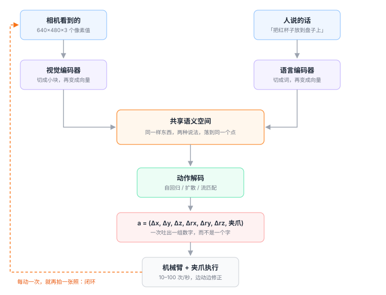

# VLA 入门手册

**这本书只讲一件事：一句人话，怎么变成机械臂的一个动作。**

<figure class="figure" markdown>

<figcaption class="caption">全书所有章节，都挂在这条链上。迷路的时候回到这张图。</figcaption>
</figure>

VLA 是 Vision-Language-Action 的缩写，中文一般译作「视觉-语言-动作模型」。它是当下具身智能（Embodied AI）最主流的技术路线，也是让「通用机器人」这个喊了三十年的口号第一次有了具体形状的东西。

但它被讲得异常混乱。有人把它说成「机器人版 ChatGPT」，有人把它等同于某个具体模型，还有人拿一段 30 秒的演示视频宣称通用机器人已经实现。这些说法都不算全错，但都不足以让你真正理解它。

这本书的写法是：**把 VLA 拆成一条流水线，一节一节讲清楚每个零件在干什么、为什么必须存在、以及它解决不了什么。**

---

## 为什么这本书不教写代码

因为写代码这件事，恰恰是初学者最容易获得虚假成就感的地方。

照着教程跑通一个 OpenVLA 的推理脚本，你得到的是「屏幕上出现了一串数字」；但你不会因此知道那串数字为什么是 7 个、为什么有正负、为什么有些模型输出的是 50 步的序列。而这些「为什么」，才是理解 VLA 的全部。

所以这本书的处理是：

- **概念优先**：每个概念先给类比，再给机制，最后才提一句「它在代码里大概长什么样」；
- **不要求环境**：全书没有一行需要你运行的命令；
- **保留伪代码**：每章末尾有 3–5 行伪代码，用途是让你把抽象概念锚定到一个具体的形状上，不是让你去实现它。

如果你确实想动手，附录里的 [零硬件游乐场](appendix/playground.md) 给了几台不花钱的模拟环境，但那属于「读完之后的选修课」。

## 如果你只有一小时

按这个顺序读，能拿到 80% 的骨架：

| 顺序 | 章节 | 为什么是它 |
|---|---|---|
| 1 | [1.1 五个误解](part0-why/00-five-misconceptions.md) | 先把错误直觉清掉，后面才装得进去 |
| 2 | [1.3 一句话定义](part0-why/02-definition.md) | 全书的地基，只有一个公式 |
| 3 | [2.3 动作：机器人怎么"动"](part1-three-words/06-action.md) | 90% 的人卡在这里而不自知 |
| 4 | [3.3 动作解码的三种流派](part2-connecting/09-action-head.md) | 看论文时最先要认出的东西 |

## 这本书适合谁

**适合：完全零基础**

说不清神经网络是什么也没关系。第 2.0 章专门补了三个地基概念，用类比讲，不推公式。

**适合：有编程基础但不碰机器人**

你会更快。可以跳过 2.0，直接从 2.3「动作」开始——那是最反直觉的一章。

**适合：想快速建立全局地图的人**

读 1.1、1.3、5.1 三节，两小时能拿到一张完整的谱系图，之后看论文不会迷路。

**不适合：想马上训模型的人**

这本书给不了你算力、数据和调参经验。它解决的是「看不懂」，不是「跑不通」。

## 全书结构

全书分七部分，是一条从「破」到「立」再到「疑」的线：

**第一部分**先把流行说法里的误解拆掉，给出 VLA 的正式定义。
**第二部分**把「视觉」「语言」「动作」三个词分别拆开，讲清每个模态自己的难处。
**第三部分**回答最核心的问题：这三样东西凭什么能拼在一起。
**第四部分**讲训练——模型到底在拟合什么，为什么模仿学习会翻车。
**第五部分**铺一张模型谱系地图，让你能按「解决什么问题」给论文归类。
**第六部分**是最诚实的部分：它为什么还没普及，以及怎么判断一个 VLA 是真行还是在演。
**第七部分**给三条不同的继续学习路径。

<figure class="figure" markdown>

<figcaption class="caption">七部分的关系：先拆误解，再补零件，然后装配，接着看成品，最后看它到底能不能用。</figcaption>
</figure>

---

<a class="md-button md-button--primary" href="reading-guide/">开始读 →</a>

