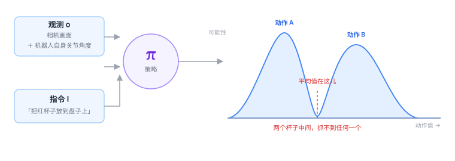

# 1.3 VLA 的一句话定义

前面两节都是「破」。这一节开始「立」。

VLA 的全部内容，可以压缩成一行式子：

$$
\pi(a \mid o, l)
$$

就这个。剩下的所有章节，都是在解释这三个字母和这个竖线。

<figure class="figure" markdown>

<figcaption class="caption">给定观测和指令，模型输出的是一整张「动作的可能性地图」，而不是一个动作。</figcaption>
</figure>

---

## 逐个拆开

### $\pi$：策略

$\pi$ 是希腊字母 pi，在强化学习里是**策略（policy）**的标准记号。

「策略」的意思是：**在某个情况下，我打算怎么做。**

注意它描述的是「打算」，不是「结果」。同一个局面，你可以选择稳妥的做法，也可以赌一把。策略描述的是这个选择的偏好，而不是某个具体的动作。

这就是为什么它的输出是一个**概率分布**，而不是一个值。

### $o$：观测

$o$ 是 observation，观测。这是最容易理解错的一项。

很多人以为 $o$ 就是「相机拍的照片」。不对。真实的 $o$ 通常包含两部分：

| 组成 | 内容 | 举例 |
|---|---|---|
| **外部感知** | 相机画面，可能是一路或多路 | 手腕相机 + 第三视角相机 |
| **本体感知**（proprioception） | 机器人自己的状态 | 各关节角度、末端位姿、夹爪开合度、受力 |

第二项经常被忽略，但它至关重要。

<div class="analogy" markdown>
**类比**

你闭着眼睛也能摸到自己的鼻子，因为你知道手现在在哪。

如果只看相机画面，机器人就像在看一张别人拍的视频——它知道自己「应该」在哪，但不知道「实际」在哪。
关节角度告诉它后者的真实值。

少了这一项，模型就学不会「我手已经伸过去了，不用再伸」。
</div>

### $l$：语言指令

$l$ 是 language。它可以短到两个词（「打开」），也可以长到一段话。

它不一定非得是自然语言。理论上可以用目标图像、用一段音频、用任意编码。但实践中几乎都用文本，原因在[1.2 节](01-why-vla.md)讲过：文本能被大规模预训练，而且人类不需要学习就能用。

### 竖线 $\mid$：条件

这个竖线是整句话的关键，读作「给定」。

$\pi(a \mid o, l)$ 的意思是：**在「看到了 $o$」且「被要求做 $l$」的前提下，动作 $a$ 的分布。**

它和 $\pi(a)$ 是两回事。后者是「不管什么情况，我一般都怎么做」——那是没有条件的行为习惯。加了竖线，才是「看着办」。

### $a$：动作

$a$ 是 action。它是全书最容易被轻轻带过、但实际最难的一项。第 [2.3 节](../part1-three-words/06-action.md)会专门讲，这里只说一句：

**$a$ 不是「往前走」，是一组数字。**

典型形式是 7 维：

$$
a = (\Delta x,\ \Delta y,\ \Delta z,\ \Delta r_x,\ \Delta r_y,\ \Delta r_z,\ g)
$$

前三个是末端执行器在三个方向上的位移，中间三个是旋转，最后一个是夹爪的开合度。

---

## 为什么输出必须是「分布」

这是本节最重要的一点。

如果只是「输入图像和文字，输出动作」，那用回归模型直接拟合一个函数 $a = f(o, l)$ 不就行了？为什么要绕一圈，输出一个概率分布？

因为**同一个场景，合理的动作往往不止一个。**

看那张图：桌上有两个杯子，你要「拿一个杯子」。从左边抓合理，从右边抓也合理。

如果你训练一个模型去拟合「平均答案」，它会输出两个杯子正中间——那个位置什么都没有。**这个现象叫「模式平均」（mode averaging），是机器人学习里最经典的坑之一。**

用概率分布来描述，就绕开了这个问题：模型输出两个峰，然后在执行时**从分布里挑一个峰**，而不是取平均。

!!! note "这条线索会一直延续到第三部分"
    为什么后来的模型纷纷放弃「直接回归」、改用扩散模型或流匹配？
    根源就在这里——**它们天生能表示多个峰**。

---

## 从分布到动作：怎么挑

模型给出分布之后，还要有一个动作把它变成一个具体数字。常见三种做法：

**1. 取最大值（argmax / 贪心）**

选概率最高的那个动作。稳定、可复现，但如果两个峰一样高，它只会永远选其中一个。

**2. 采样（sampling）**

按概率随机抽一个。同一个场景跑两次，动作可能略有不同。这带来多样性，也带来不确定性——生产线上没人喜欢「偶尔换个抓法」。

**3. 带温度的采样**

用一个参数控制「保守还是随机」。温度趋近 0 就退化成 argmax，温度升高就更多样。

实践中最常见的是「训练时采样、部署时取最大值」，或者干脆让模型自己输出一个确定值（很多扩散模型的做法是固定噪声）。

---

## 这个定义藏了三个假设

$\pi(a \mid o, l)$ 这个写法很干净，但干净是要付代价的。它悄悄假设了三件事，而这三件事在真实世界里都不完全成立。

### 假设一：当前观测就够了（马尔可夫性）

式子里只有「当前的 $o$」，没有「过去的 $o$」。这隐含地假设：**当前这一刻的画面包含了做决定所需的全部信息。**

显然不成立。

> 一个人从你面前走过，你只看到一帧静止的画面，无法判断他在往左走还是往右走。

这就是为什么实际的 VLA 输入很少是单帧，而是**堆叠最近几帧**（比如 2–4 帧），或者用一个带记忆的网络结构。$\pi$ 的写法没变，但 $o$ 悄悄变成了 $o_{t-k:t}$。

### 假设二：指令是明确无歧义的

「把杯子拿过来」——拿哪个？给谁？

真实的人类指令充满省略和指代，而模型必须把它映射成一个确定的动作。这个矛盾目前靠两件事缓解：一是让模型从画面里自己猜（通常猜最显眼的那个），二是让用户说得更具体。

**在真实部署里，含糊指令导致的失败比技术故障多得多。**

### 假设三：训练时「正确答案」是唯一的

训练时，模型看到的是「专家在这一帧做了什么」，然后学着去拟合。

但专家做的动作只是**一个**合理动作。如果同一个局面有一百种正确做法，训练数据里只会出现其中一种，模型就会误以为「只有这一种是对的」。

这个问题的后果，就是[第 4.2 节](../part3-training/11-behavior-cloning.md)要讲的「分布漂移」。

---

## 它在代码里长什么样

只为了让你看到形状，不需要运行：

```python
# 概念示意，不是真实实现
def policy(obs, lang):
    x = vision_encoder(obs["image"])       # 图像 → 视觉 token
    y = proprio_encoder(obs["qpos"])       # 关节角 → 本体 token
    z = lang_encoder(lang)                 # 文本 → 语言 token
    h = transformer(torch.cat([x, y, z]))  # 拼成一个序列，过主干
    dist = action_head(h)                  # 特征 → 动作分布
    return dist                            # 注意：返回的是分布，不是动作

dist = policy(obs, "把红杯子放到盘子上")
action = dist.sample()                     # 或者 dist.mode()，取峰值
robot.step(action)                         # 执行，然后等着看下一帧
```

读这段代码时注意两件事：

1. **三个模态最后被拼成了一个序列**——这就是 Transformer 统一架构的样子；
2. **函数返回的是分布**，取动作是外面单独一步。这个分离在很多开源代码里是显式的（`predict_action` 返回 logits 或噪声，`select_action` 再处理）。

---

## 一句话说完

> **VLA 就是一个函数：给它「现在看到什么」和「要它干什么」，它告诉你「每个动作有多大概率是对的」。**

后面所有的复杂度——视觉怎么编码、语言怎么对齐、分布怎么表示、误差怎么累积——都是在这个骨架上长出来的肉。

<div class="quiz" markdown>
**自测三问**

1. $\pi(a \mid o, l)$ 里的 $o$ 为什么不只是相机画面？少了本体感知会怎样？
2. 如果模型直接回归一个动作值，会遇到什么问题？为什么输出分布能绕开它？
3. 这个定义隐含的三个假设分别是什么？各自在什么情况下会失效？
</div>

<div class="takeaway" markdown>
VLA 是一个条件策略函数 π(a|o,l)：给定观测和指令，输出动作的概率分布。
输出分布而不是单个值，是为了容纳「同一场景有多种合理动作」这个事实。
</div>

---

<a class="md-button" href="../part1-three-words/03-prerequisites/">进入第二部分：三个词拆开看 →</a>
