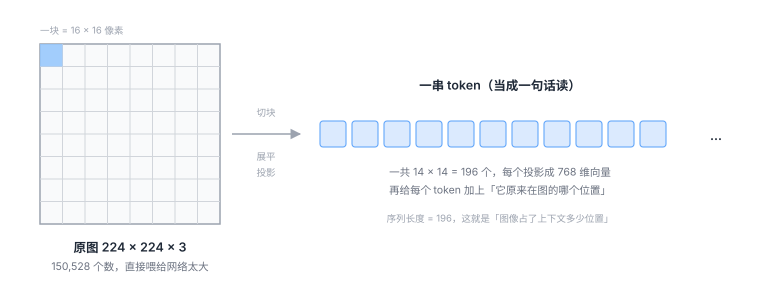

# 2.1 视觉：一张图怎么变成一串数字

## 图像本来就是数字

一张 640×480 的彩色照片，在计算机眼里是这样的：

```text
640 × 480 × 3 = 921,600 个 0 到 255 之间的整数
```

三个通道分别是红、绿、蓝。就这么简单，没有任何神秘的东西。

所以「让机器看懂图」这件事，字面上就是把 92 万个数字变成一句「桌上有红杯子」。

问题在于：**92 万个数字里，绝大部分是冗余的。**

一片白色的墙，占了 20 万个数，但它们几乎一样。真正有用的信息——杯子的边缘在哪、盘子是什么形状——只藏在少数地方。

如果直接把 92 万个数字丢进网络，会同时遇到两个麻烦：

1. **参数爆炸**：假设第一层有 1000 个神经元，光这一层就要 9 亿个参数。
2. **没有先验**：网络不知道「相邻的像素通常是相关的」这件事，得从零学起。而这条先验是人类早就知道的常识。

所以所有视觉模型的第一个任务，都是**把这堆数字重新组织成更有结构的形式**。

历史上出现过两种组织方式。

---

## 老办法：卷积（CNN）

卷积网络的想法非常朴素：

<div class="analogy" markdown>
**类比**

拿一个 3×3 的小窗口，在整张图上从左到右、从上到下慢慢滑动。

每滑到一个位置，就看一眼这 9 个像素，判断「这里有没有一条竖边」「这里是不是一块红色」。

同一个窗口，滑遍全图——**这就是「权重共享」**。
</div>

这个设计有两个漂亮的先验：

- **局部性**：判断一个像素是什么，主要看它周围。这符合直觉。
- **平移不变**：同一个「竖边检测器」在图的左上角和右下角都适用。所以不用为每个位置单独学一套。

CNN 统治了视觉十年，到今天依然是很多系统的骨架。

但它有个特点，在 VLA 这里变成了缺点：**它的输出是一张「特征图」，不是一个「序列」。**

而语言模型的输入必须是序列。要把 CNN 的输出接进语言模型，就得额外做一步转换。

ViT 把这个转换直接省掉了。

---

## 新办法：把图当成一句话来读（ViT）

ViT（Vision Transformer）的做法，一句话说完：

> **把图切成小块，每块当成一个「词」。**

<figure class="figure" markdown>

<figcaption class="caption">切块 → 展平 → 线性投影 → 加位置编码。做完这四步，一张图和一句话在形式上就没有区别了。</figcaption>
</figure>

具体分四步：

**① 切块（patchify）**

224×224 的图，按 16×16 切成 14×14 = 196 块。

每一块是 16×16×3 = 768 个数。

**② 展平 + 投影**

把每块的 768 个数拉成一条，再用一个线性层映射成模型需要的维度（比如也是 768）。

于是 196 块变成了 196 个向量。

**③ 加位置编码**

这一步极其关键，而且经常被跳过。

Transformer 的自注意力机制有一个特点：**它对顺序完全不敏感**。你把 196 个 token 打乱喂进去，输出是一样的（只是顺序也跟着乱）。

但图像是有空间结构的。左上角那块和右下角那块，含义完全不同。

所以必须给每个 token 额外加一个「我原来在第几行第几列」的标记。这个标记就是**位置编码（positional encoding）**。

<div class="analogy" markdown>
**类比**

把一篇文章的所有字剪下来，装进一个袋子，再倒出来——字都在，但句子没了。

位置编码就是给每个字背后写上「我原来是第 37 个字」。
</div>

**④ 送进 Transformer**

到这里，196 个 token 和一句 196 个词的句子，在形式上完全一样了。可以用同一个 Transformer 处理。

这也是 VLA 能用「一个模型搞定三个模态」的根本原因：**只要都能表示成 token 序列，架构就可以复用。**

---

## 卷积和 ViT 的真正区别

不只是「一个用窗口、一个用切块」。更深层的区别在于**信息怎么流动**。

| | CNN | ViT |
|---|---|---|
| 一块信息能看到多远 | 只看邻居（3×3）；要扩大范围得堆很多层 | 一层就能看到全图任意位置 |
| 先验 | 强（局部性、平移不变） | 弱（几乎不假设什么） |
| 需要的数据量 | 少 | 多 |
| 输出形式 | 特征图 | 序列 |

「一层就能看到全图」这件事，在机器人场景里很重要。

因为机器人经常需要**远距离的关联**：「我手上这个杯子」和「远处那个盘子里还剩多少空间」——这两个信息在图上隔得很远，CNN 要堆很多层才能把它们联系起来，ViT 一层就够。

代价是：ViT 需要更多数据才能学好。这也是为什么 ViT 一直到 2020 年之后、有了大规模预训练才真正流行起来。

---

## 特征到底学到了什么

不管用 CNN 还是 ViT，编码器输出的向量都有一个共同特点：**层次性**。

```text
浅层  →  边缘、颜色块、纹理
中层  →  角点、圆弧、局部形状
深层  →  「这是个杯子」「这是个把手」「这是可抓握的区域」
```

越深，越接近「语义」，越远离「像素」。

这一点对 VLA 有直接影响：

- 抓取需要**精确的空间位置**，所以浅层特征有用；
- 「红杯子」这个概念需要**语义理解**，所以深层特征有用。

只用一种，总会缺一块。

---

## 所以现代 VLA 常常用两个编码器

这是一个很实用的设计细节，看论文时经常遇到。

以 OpenVLA 为例，它的视觉部分同时用了两个编码器：

| 编码器 | 训练方式 | 擅长什么 | 在 VLA 里的作用 |
|---|---|---|---|
| **DINOv2** | 自监督（不看文字，只看图与图的关系） | 空间结构、边缘、物体边界，非常锐利 | 告诉模型「东西在哪、边界在哪」 |
| **SigLIP** | 图文对比学习（看图配文） | 语义，「这是杯子」和「杯子」这个词对齐 | 告诉模型「这是什么」 |

然后**把两者的特征拼起来**（各取一半维度），作为视觉输入。

为什么这么干？因为它们互补：

- DINOv2 不知道「杯子」这个词，但对物体轮廓极其敏感——抓取需要这个；
- SigLIP 知道语义，但对精细空间位置的敏感度不如 DINOv2。

只用一个，都会在某方面吃亏。拼起来，两边的好处都要。

!!! note "看到双编码器不要慌"
    论文里写成 `fused_vision = concat(DINOv2(img)[:1024], SigLIP(img)[:1024])` 这种形式时，
    意思就是「两个特征各取一半，接在一起」。
    这不是什么高深设计，就是「两个专家投票」的工程实现。

---

## 一个被忽略的成本：token 数量

这一点很少有人在小白教程里讲，但它决定了很多架构选择。

**图像会占掉语言模型上下文的一大块。**

算一笔账：

- 一张 224×224 的图，patch 16 → 196 个 token
- 如果接两路相机（第三人称 + 手腕），就是 392 个
- 如果堆 3 帧历史，就是 1176 个
- 一个典型 7B 语言模型的上下文窗口是 4096 个 token

**图像已经吃掉了四分之一还多。** 剩下的空间要放指令、要生成动作，很紧张。

所以你会看到各种各样的压缩手段：

- **降低分辨率**：224 而不是 448，token 数直接少四倍；
- **池化/重采样**：用一个小网络把 196 个 token 压成 64 个（Q-Former、Perceiver 这类结构）；
- **只取部分层**：不用最后一层，用中间某层的特征；
- **单相机**：很多系统只用一路相机，就是为了省 token。

<div class="analogy" markdown>
**类比**

上下文窗口像一个背包，容量固定。

图像是一台很占地方的相机，指令是一张纸，动作输出是你要带回来的东西。

相机带多了，纸就放不下，东西也没地方装。所以必须在「看得清楚」和「装得下别的」之间取舍。
</div>

这个矛盾在后面讲「推理速度」（[6.1 节](../part5-reality/16-bottlenecks.md)）时会再次出现——压缩 token 不只是省显存，也直接决定了模型能跑多快。

---

## 相机怎么摆，也是个设计问题

VLA 的输入常常不止一路相机。常见组合：

| 相机 | 位置 | 优势 | 劣势 |
|---|---|---|---|
| **第三人称** | 固定在场景上方或侧面 | 能看到全局，知道自己和物体的相对关系 | 被遮挡就完蛋；视角一变就失效 |
| **腕部相机** | 装在末端执行器上 | 抓取时看得最清楚，不受遮挡 | 看不到自己要去的目标在哪 |

只用第三人称，抓取精度差；只用腕部，找不到目标。

所以主流做法是**两个都用**，让模型自己融合。代价是 token 翻倍——又回到上面那个矛盾。

---

## 一句话总结这章

视觉部分做的事，就是**把一个二维的像素阵列，重新组织成一个 Transformer 能读的序列，并且尽量保留空间精度和语义信息**。

切块是为了变成序列，位置编码是为了不丢空间结构，双编码器是为了兼顾「在哪」和「是什么」，压缩是为了省上下文。

四个动作，四个动机，没有一个是随便设计的。

<div class="quiz" markdown>
**自测三问**

1. 如果没有位置编码，ViT 会发生什么？为什么 Transformer 本身「不在乎顺序」？
2. 为什么现代 VLA 常常同时用 DINOv2 和 SigLIP？它们各自补上了对方的什么短板？
3. 图像 token 太多会带来什么连锁反应？至少说出两条，一条关于训练，一条关于推理。
</div>

<div class="takeaway" markdown>
视觉编码的核心动作：切块变序列、加位置编码保空间、双编码器兼得「在哪」与「是什么」、压缩省上下文。
</div>

---

<a class="md-button" href="../05-language/">下一节：语言 →</a>
