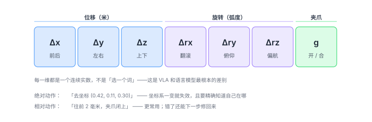

# 2.3 动作：机器人怎么「动」才算动

这一章是全书技术密度最高的一节，也是最容易被教程含糊带过的一节。

原因很简单：写教程的人大多从视觉或 NLP 转过来，对「动作」这个东西没有肌肉记忆。于是「模型输出一个动作」这句话就写完了，读者却完全不知道这个动作到底长什么样。

---

## 一个动作，是 7 个数

在绝大多数 VLA 系统里，一个动作是一个 7 维向量。

<figure class="figure" markdown>

<figcaption class="caption">七个数，三类含义：往哪走（3 个）、转多少（3 个）、抓不抓（1 个）。</figcaption>
</figure>

前三个是**末端执行器**（夹爪或工具）在三个方向上的位移，单位通常是米。

中间三个是**旋转**，单位是弧度。

最后一个 $g$ 是**夹爪的开合度**，通常 0 到 1 之间，0 是全开，1 是全闭（或者反过来，取决于约定）。

!!! warning "维度不是固定的"
    7 维是「单臂 + 二指夹爪」的标准配置。换一个本体，维度立刻变：

    - 双臂：14 维
    - 带灵巧手（比如 6 指）：7 + 12 或更多
    - 人形机器人：可能 30 维以上（还要含移动底盘）

    这个事实后面会变成一个巨大的麻烦，见本章最后一节。

---

## 坐标系：动作总是「相对某个东西」

「往前 2 厘米」这句话，得先知道「前」是哪个方向。

机器人里至少有三个常用的坐标系：

| 坐标系 | 含义 | 适合什么 |
|---|---|---|
| **世界系** | 以房间地面某点为原点 | 导航、移动底盘 |
| **基座系** | 以机器人底座为原点 | 单臂操作，最常见 |
| **末端系** | 以夹爪本身为原点 | 抓取、精细操作 |

同一个动作，在这三个系里的数字完全不同。

**VLA 输出的动作，绝大多数是「基座系下的末端位姿增量」。** 也就是：以机器人的肩膀所在位置为原点，告诉它「夹爪相对于现在的位置，该往哪挪多少」。

这个约定很重要，因为它让模型不需要知道世界有多大、房间在哪——它只管自己手边的几厘米。

---

## 关节空间 vs 笛卡尔空间

这是机器人学里最基本的一个区分，但很多人第一次听说时会懵。

假设你要让机械臂把夹爪移到桌上一个点。有两种说法：

**说法 A（笛卡尔空间 / 任务空间）**

> 「夹爪移到 (0.4, 0.2, 0.1)。」

**说法 B（关节空间）**

> 「一号关节转到 30°，二号转到 −45°，三号转到 60°，四号转到 15°，五号转到 90°，六号转到 0°。」

两种说法描述的是**同一个结果**，但表达层次完全不同。

<div class="analogy" markdown>
**类比**

你想让手摸到鼻子。

说法 A 是「手移到鼻尖前面 2 厘米」——你在描述**目标**。
说法 B 是「肩关节转 20 度、肘关节弯 90 度、腕关节转 15 度」——你在描述**每个关节怎么办**。

对你自己来说，你从来不用想 B，你只想 A，身体自动完成了 B 的计算。
</div>

**为什么 VLA 几乎都输出笛卡尔空间的动作？**

三个原因：

1. **跨本体更容易**。不同机器人的关节数、长度、结构完全不同，但「末端往哪走」这个描述是通用的。
2. **和人怎么想事情一致**。「把杯子拿起来」是个任务级的目标，不是关节角度。
3. **误差更容易修正**。末端位置错了，下一步直接补；关节角度错了，可能导致整条手臂姿态扭曲。

那个「从 A 算出 B」的过程，叫**逆运动学（inverse kinematics，IK）**。它由底层控制器负责，VLA 不管。

所以真实的调用链是：

```text
VLA 输出：(Δx, Δy, Δz, Δrx, Δry, Δrz, g)
    ↓
逆运动学：算出六个关节各自该到多少度
    ↓
轨迹规划：保证这条路径不撞到东西
    ↓
伺服控制：每个电机给多少电流
```

**VLA 只负责第一行。** 这也是为什么它不可能取代传统控制（[1.1 节](../part0-why/00-five-misconceptions.md)说过）。

---

## 旋转怎么表示：一个真正的坑

位移用三个数表示很自然（x、y、z）。旋转呢？

这里藏着 VLA 里最不直观的一个设计决策。

### 方案一：欧拉角（roll / pitch / yaw）

用三个角度分别表示绕三个轴的旋转。**人最容易理解**，也是很多教程默认的表示。

**问题一：万向锁。**

当 pitch 转到 ±90° 时，roll 和 yaw 会变成绕同一根轴转，**两者失去独立性**。这时候你只丢了一个自由度，控制会突然变得极其别扭。

**问题二：不连续。**

从 179° 转到 −179°，实际只转了 2°，但在数值上差了 358°。神经网络看到一个巨大的跳变，会学得很痛苦。

### 方案二：四元数（quaternion）

用四个数表示旋转，没有万向锁，插值也平滑。

**问题：双重覆盖。**

四元数 $q$ 和 $-q$ 表示的是**完全相同的旋转**。

对人类来说这没问题，但神经网络看到的是两组完全不同的输入对应同一个输出——**这是一对矛盾样本，会直接破坏训练。**

### 方案三：6D 旋转表示（现在的标准做法）

**把 3×3 旋转矩阵的前两列拿出来，6 个数。**

为什么只要两列？因为旋转矩阵的三列是互相正交的，第三列可以由前两列叉乘得到。所以 6 个数就够完整描述一个旋转。

这个表示的好处：

- **没有冗余**：不会出现两个数描述同一个东西；
- **没有不连续**：矩阵元素是连续变化的，不会突然跳；
- **网络友好**：6 个连续实数，直接回归就行。

**用了 6D 旋转之后，动作维度就从 7 变成了 10**：3 + 6 + 1。

所以你会看到两种配置并存，都不是错的：

- **7 维**：3 位移 + 3 欧拉角 + 1 夹爪。简单直观，早期工作和不少现役系统仍在用；
- **10 维**：3 位移 + 6 旋转 + 1 夹爪。数值性质更好，新系统更倾向这一套。

如果你自己设计系统，10 维通常更省心——省下的是日后调参和排查「为什么学不会旋转」的时间。

!!! note "读论文时的对照表"
    | 旋转表示 | 动作总维度 |
    |---|---|
    | 欧拉角 | 7（3 + 3 + 1） |
    | 6D 旋转 | 10（3 + 6 + 1） |
    | 四元数 | 8（3 + 4 + 1） |

    看到 7 维，通常是欧拉角；看到 10 维，通常是 6D 旋转。
    **这个细节能帮你判断一篇论文的工程成熟度**——用 6D 的，一般踩过坑。

---

## 绝对动作 vs 相对动作

**绝对动作**：直接给出目标位姿的绝对值。

> 「夹爪应该在 (0.42, 0.11, 0.30)，朝向这样。」

**相对动作（delta）**：给出相对于当前状态的增量。

> 「从当前位置往前 2 毫米，往左 5 毫米，转 3 度。」

**为什么相对动作更常用？**

三个理由，每一个都很实际：

1. **不需要精确的绝对定位**。机器人通过视觉估计自己位置，总有几毫米误差。如果用绝对动作，这个误差会一直存在；用相对动作，下一步可以自然修正。
2. **对相机外参不敏感**。相机装歪了一点，绝对坐标全错，但相对位移还好。
3. **闭环友好**。每一帧重新算一次增量，天然就是一个反馈控制器。

代价是：**误差会累积**。如果每一步都往前多走 0.5 毫米，走一百步就偏了 5 厘米。这就是为什么动作最好别只闭环到视觉上，还要有本体感知来兜底。

---

## 时间维度：机器人动作是「一段」，不是一个点

这是动作和语言最本质的区别之一。

语言模型生成一个词，那一个词就是最终产物。机器人输出一个动作，那只是**这一瞬间**该怎么办——半秒后情况就变了。

于是有个问题：**模型该多快输出一次？**

### 控制频率的现实

| 层级 | 典型频率 | 说明 |
|---|---|---|
| 电机伺服 | 1000 Hz | 底层电流环 |
| 轨迹规划 | 100–500 Hz | 保证路径平滑 |
| **VLA 输出** | **3–10 Hz**（早期）/ **30–50 Hz**（新模型） | 上层决策 |
| 人类操作 | 约 10 Hz | 人手的反应速度 |

**矛盾就在这**：机器人底层需要 100 Hz 的指令流，但一个 70 亿参数的模型推理一次要几百毫秒，只能跑到 3–10 Hz。

如果直接让 VLA 以 5 Hz 输出，中间那 20 毫秒的空档，机械臂要么停着（动作一顿一顿），要么按上一次的指令硬走（容易撞）。

### 解法：动作块（action chunk）

**一次输出未来 k 步的动作，而不是一步。**

```text
普通做法（每帧输出 1 个动作）：
帧1 → a₁   帧2 → a₂   帧3 → a₃   ...     每帧都要推理一次

动作块（一次输出 k 个）：
帧1 → [a₁, a₂, ..., a_k]                  推理一次，执行 k 帧
帧(k+1) → [a_{k+1}, ..., a_{2k}]
```

这样推理频率可以降到原来的 1/k，而底层依然有高频指令。

这个技巧最早是 **ACT**（2023）推广开的，现在几乎成了标配。π₀ 一次预测 50 步，在 50 Hz 下就是 1 秒的动作——所以它既能跑 50 Hz，又只需要每秒推理几次。

!!! note "动作块的两个副作用"
    **好处**：动作更连贯。因为 k 步是一次性生成的，彼此之间天然连贯，不会出现「每一步都重新决策」导致的抖动。

    **坏处**：反应变慢。如果执行到第 30 步时突然出现意外（有人伸手过来），模型要等这一块执行完才能反应。
    后来的改进办法是「重叠执行」——不用等 k 步全走完，走一半就生成下一块，两段重叠着用。

---

## 为什么要归一化

所有 VLA 都会把动作归一化到 $[-1, 1]$ 区间再训练。

原因很实在：

- 位移可能是 0.001 米，旋转可能是 0.8 弧度，夹爪是 0 或 1——**量级差了几百倍**；
- 神经网络对输入输出的量级很敏感，量级差太大，梯度会被大数主导，小数那部分学不动。

归一化的做法通常是：统计整个数据集每一维的 1% 和 99% 分位数，然后线性映射到 $[-1, 1]$。执行时再反归一化回来。

**一个小坑**：不同数据集的归一化统计量不一样。如果混用多个数据集训练，归一化参数没对齐，模型学出来的动作幅度就会乱。这是很多开源项目复现失败的原因之一。

---

## 动作是「多峰」的

同一个场景，合理动作往往不止一个。

- 抓杯子：可以从正上方抓、从侧面抓、从斜 45° 抓；
- 放盘子：可以轻放、可以快速放下；
- 绕障碍：可以从左边绕、从右边绕。

人类示教数据里，这两种做法都会出现。

如果用简单的回归（最小化均方误差）去学，模型会输出**两个峰的平均**——落在中间那个没意义的位置。

这就是[1.3 节](../part0-why/02-definition.md)讲过的「模式平均」。也是为什么动作解码要用概率模型（扩散、流匹配），而不是直接回归。

---

## 最后一个，也是最麻烦的问题：不同机器人的动作不一样

前面说过，动作维度因本体而异：

| 本体 | 动作维度 | 备注 |
|---|---|---|
| 单臂 + 二指夹爪 | 7 或 10 | 最常见 |
| 双臂 | 14 或 20 | 两个 7/10 拼起来 |
| 带灵巧手 | 20+ | 每根手指都有自由度 |
| 移动底盘 | 2–3 | 线速度 + 角速度 |
| 人形 | 30+ | 腿 + 腰 + 双臂 + 手 |

**这意味着一个在单臂数据上训好的模型，输出层根本没法直接用在双臂机器人上。**

这个问题的学名叫**跨本体（cross-embodiment）**。目前有三种应对方式：

1. **统一成末端位姿**：不管什么机器人，都只输出「末端在哪、朝向如何、夹爪开合」。把差异藏在底层控制器里。这是最主流的做法。
2. **零填充**：给每台机器人一个固定长度的动作向量，用不到的位置填 0，同时告诉模型「这是哪台机器人的第几个关节」。
3. **分本体训练专门的头**：共享主干，每个本体一个输出层。参数效率低，但效果稳。

**这三种方式没有哪个是完美的。** 跨本体现在依然是开放问题（[6.1 节](../part5-reality/16-bottlenecks.md)会再提），这也是为什么「通用机器人」离真正落地还有距离。

---

## 本章小结

动作看起来只是「几个数字」，但它牵扯的东西比想象中多：

- **坐标系**决定了这个数字相对谁；
- **关节空间 vs 笛卡尔空间**决定了模型输出的是「目标」还是「每个关节怎么办」；
- **旋转表示**决定了网络好不好学（6D 是当前最优解）；
- **绝对 vs 相对**决定了误差怎么累积；
- **时间维度**决定了推理频率和动作块的设计；
- **多峰性**决定了为什么需要概率模型；
- **跨本体**决定了「通用」这个词能走多远。

**这七件事，没有一件是视觉或语言那边会遇到的。** 这就是为什么 VLA 里真正难的部分在动作这一侧。

<div class="quiz" markdown>
**自测三问**

1. 为什么 VLA 更愿意输出笛卡尔空间的末端位姿，而不是关节角度？说出两条理由。
2. 欧拉角的问题是什么？6D 旋转表示为什么能绕开它？为什么四元数也不理想？
3. 动作块（action chunk）解决了什么问题？它又引入了什么新问题？
</div>

<div class="takeaway" markdown>
动作是 7 或 10 个连续实数：3 个位移 + 3/6 个旋转 + 1 个夹爪。
它相对基座系、通常是增量、需要归一化、有多峰性、且因本体而异——这五件事构成了 VLA 真正的技术难点。
</div>

---

<a class="md-button" href="../../part2-connecting/07-alignment/">进入第三部分：怎么把三者连起来 →</a>
