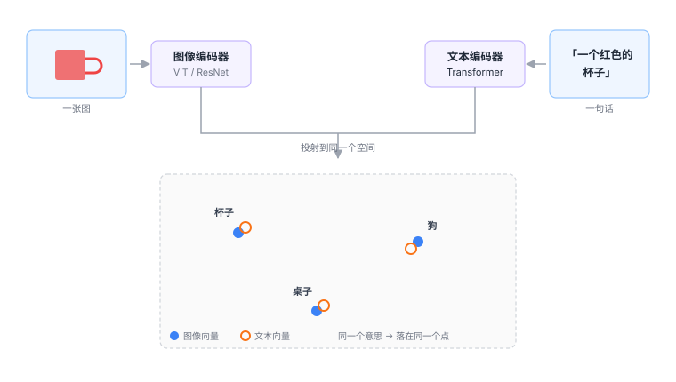

# 3.1 对齐：CLIP 为什么是分水岭

## 先看一个死结

前面两章分别讲了视觉和语言。它们各自都能变成向量。

问题是：**这两组向量在不同的空间里。**

图像的向量是「像素长什么样」，文本的向量是「这个词跟哪些词经常一起出现」。它们是两套完全独立的坐标系。

就像一个人只会说中文，一个人只会说英文，各自都说得很好——但你要他们交流，中间必须有个翻译。

**CLIP 做的就是这个翻译，而且做法比翻译更彻底：它不是把中文译成英文，而是发明了第三种语言，让两边都会说。**

<figure class="figure" markdown>

<figcaption class="caption">图像编码器和文本编码器被一起训练，让「同一个意思」的图和文落到同一个点上。</figcaption>
</figure>

---

## CLIP 的训练方式：对比学习

CLIP 的训练数据极其简单：**互联网上抓来的图文对**。

一张图配一段描述它的文字。四亿对。

训练过程是这样的：

### 第一步：一个 batch 里放 N 对图文

假设 N = 4：

```text
图A ↔ 文A   「一只狗在草地上」
图B ↔ 文B   「一辆红色的汽车」
图C ↔ 文C   「厨房里的桌子」
图D ↔ 文D   「一个人在看手机」
```

### 第二步：把图和文分别编码

4 张图得到 4 个向量，4 段文字得到 4 个向量。

### 第三步：两两算相似度，得到一个 4×4 矩阵

```text
        文A    文B    文C    文D
 图A  [ 0.92  -0.31  -0.08   0.05 ]
 图B  [-0.22   0.88  -0.14   0.11 ]
 图C  [-0.05  -0.19   0.90  -0.07 ]
 图D  [ 0.09   0.03  -0.11   0.86 ]
       └──────── 对角线 = 正确答案 ────────┘
```

### 第四步：让对角线变高，其他变低

训练目标一句话：**让每一行里，自己那一列的值最大。**

对图 A 来说，它必须做到「和文 A 最像，和文 B/C/D 都不像」。

!!! note "为什么负样本是关键"
    如果只做「图 A 靠近文 A」，模型可以偷懒：把所有向量都变成同一个值，全部靠近。

    正是因为**同一批次里的其他文字被当作负样本**（图 A 必须远离文 B/C/D），模型才被迫去区分「狗」和「汽车」。

    这个设计叫**对比学习（contrastive learning）**。它的精髓不在「拉近」，而在「推远」。

### 第五步：重复四亿次

最后得到的两个编码器，输出的向量落在同一个空间里。

**这就是「对齐」（alignment）**：不是两个空间互相映射，而是它们从一开始就被训练成了同一个空间。

---

## 对齐之后能干什么

### 一、零样本分类

传统分类器：训练时见过「猫」这个类别，才能识别猫。训练时没有的类别，永远认不出。

CLIP 不一样：给它一张图，和一堆候选文字（「一张狗的照片」「一张猫的照片」「一张汽车的照片」），算相似度，选最高的。

**换一个类别，不用重新训练，只要改文字。**

这个能力叫**开放词汇（open-vocabulary）**。它对机器人的意义是决定性的：

> 训练数据里没见过的物体，只要你能用语言描述它，模型就有可能认出来。

<div class="analogy" markdown>
**类比**

传统视觉模型像一个只认识 1000 种东西的鉴定师，遇到不认识的就摇头。

CLIP 像一个读过很多书的人：他可能没见过这个东西，但你描述一下，他能判断「听起来像是什么」。
</div>

### 二、为 VLA 提供了「语义地基」

这是 CLIP 对 VLA 最重要的贡献，也是最容易被忽略的一点。

回想[2.1 节](../part1-three-words/04-vision.md)讲的：视觉编码器输出的是特征向量。没有 CLIP 之前，这些特征是**纯粹视觉的**——它们知道「这里有边缘」「这里有纹理」，但不知道「这是杯子」。

有了 CLIP 式的对齐，「杯子」这个词的向量和「杯子的图像」的向量是同一方向的。

于是当模型读到指令里的「杯子」，它可以在视觉特征里找到方向一致的那一块。

**「听懂指令」这件事，物理上就是这么发生的。**

### 三、解释了为什么 VLA 能跨物体泛化

训练数据里有红杯子，测试时来了个蓝杯子。

如果模型只是记住了「红色圆形物体」，它会失败。但因为视觉特征是语义对齐的，「蓝杯子」和「红杯子」在向量空间里方向接近，所以模型能迁移过去。

**这就是为什么新物体泛化相对容易**（[1.1 节](../part0-why/00-five-misconceptions.md)那张表里的第一行），而新场景、新本体难得多。

---

## CLIP 不是万能的

这一节很重要。很多介绍 CLIP 的文章只讲好处，然后读者就会疑惑：既然 CLIP 这么好，为什么还需要别的东西？

因为 CLIP 有三个明显的短板。

### 短板一：它对空间细节不敏感

CLIP 的训练目标是「整张图和整段话匹配」。

「一个人在左边，一只狗在右边」和「一只狗在左边，一个人在右边」——这两句话的语义向量**几乎一样**，因为 CLIP 用的是全局池化，位置信息在池化时被抹掉了。

**但机器人极度依赖位置。**

「抓左边的杯子」和「抓右边的杯子」，在 CLIP 看来几乎没区别。这就是为什么 VLA 不能只用 CLIP 式的特征（[2.1 节](../part1-three-words/04-vision.md)讲的 DINOv2 就是为了补这块）。

### 短板二：它对「关系」和「数量」理解很差

「三个苹果」「苹果在盘子上」「杯子旁边没有东西」——这类描述，CLIP 经常判断错。

原因是图文对数据里，这种精确的关系描述很少，而且对比学习的目标不惩罚这类错误（「一个苹果」和「三个苹果」的图，整体语义确实很像）。

### 短板三：它的负样本是「随机凑的」

batch 里的负样本是随机配的，大部分时候差异巨大（狗 vs 汽车），模型很容易区分。

真正难的是「狗 vs 狼」「杯子 vs 碗」这种细粒度区分，而随机负样本里很少出现。

后来的改进（比如 SigLIP）改掉了 softmax 的做法，用 sigmoid 逐对计算，**不再需要整个 batch 归一化**，可以开很大的 batch，负样本更多样。

!!! note "为什么新模型更爱用 SigLIP"
    CLIP 用的是 softmax 对比损失，需要在整个 batch 上归一化——batch 越大越好，但显存吃不下。

    SigLIP 用 sigmoid，每对图文独立算「是/不是」，不依赖 batch 内其他样本。
    **结果是可以用更小的 batch、更省显存，效果还差不多。**

    这就是为什么 OpenVLA、π₀ 这些新一代模型，视觉编码器都用 SigLIP 而不是 CLIP。
    名字像，思路一样，工程上更好用。

---

## 一个更本质的视角

CLIP 的意义不只是「一个可用的视觉编码器」。

它证明了一件事：**不同模态的信息，可以被映射到同一个语义空间里，而且这个空间是连续的、可运算的。**

这句话是 VLA 的理论前提。

因为如果图和文不能共存于一个空间，那「看图理解指令」就只能靠一堆手工规则拼接（先检测物体、再匹配名词、再查动作表），永远做不到端到端。

CLIP 之后，这条路才通了：

```text
图  →  图像编码器  →  ┐
                      ├→  同一个空间  →  后续模块
文  →  文本编码器  →  ┘
```

**你后面看到的所有 VLA 架构图，中间那一块「拼起来」的地方，思想源头都是这里。**

---

## 那动作呢？动作也被对齐了吗

这是个好问题，而且答案是：**没有，至少没有以同样的方式对齐。**

CLIP 对齐的是「视觉」和「语言」，因为互联网上有海量现成的图文对。

但「动作」没有对应的互联网数据。你不可能在网上找到「这张图配这个动作」的四亿对。

所以动作这一侧的对齐，只能靠**机器人数据**，规模小六七个数量级（[1.2 节](../part0-why/01-why-vla.md)说过）。

**这正是 VLA 最根本的不对称**：视觉和语言有互联网，动作没有。

这个不对称解释了后面几乎所有的工程选择——为什么要用预训练、为什么动作头要单独设计、为什么数据是瓶颈。

<div class="quiz" markdown>
**自测三问**

1. 对比学习里，如果只用正样本（拉近匹配的图文），会发生什么？为什么负样本不可少？
2. CLIP 的零样本分类能力，对机器人来说意味着什么？举一个传统方法做不到的例子。
3. 为什么 CLIP 分不清「左边的人」和「右边的人」？这个短板在 VLA 里怎么被补上？
</div>

<div class="takeaway" markdown>
CLIP 用对比学习把图和文映射到同一个语义空间，让「词」和「物」可以互相检索。
它给了 VLA 语义地基，但丢掉了空间精度——所以现代系统会再配一个 DINOv2 补上。
</div>

---

<a class="md-button" href="../08-fusion/">下一节：融合 →</a>
