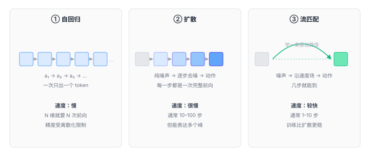

# 3.3 动作解码：三种把想法变成数字的流派

到这里，模型已经有了一份「理解当前局面」的特征向量。剩下最后一公里：

**怎么把它变成 10 个具体的数字？**

这一节是各个 VLA 差异最大的地方。看论文时，只要认出它用哪种动作头，基本就能判断它的速度、精度和适用场景。

<figure class="figure" markdown>

<figcaption class="caption">三种流派的本质区别：怎么从「一个想法」走到「一组数字」，以及走多少步。</figcaption>
</figure>

---

## 先排除一个显而易见的答案

最直接的做法：接一个全连接层，直接回归出 10 个数。

$$
\hat{a} = W h + b
$$

损失函数用均方误差：

$$
\mathcal{L} = \| \hat{a} - a \|^2
$$

简单、快、一次前向就出结果。**为什么不用？**

两个原因。

### 原因一：多峰问题

[1.3 节](../part0-why/02-definition.md)讲过：同一个场景有多种合理动作。MSE 会输出它们的平均，而平均值往往是个无效动作。

这个问题在高维空间更严重。10 维动作里，即使每一维都只有两个合理值，组合起来就有 $2^{10} = 1024$ 种合理动作。它们的「平均」几乎必然落在物理上不可行的区域。

### 原因二：误差分布不是高斯的

MSE 隐含假设「预测误差服从正态分布」。但机器人的动作误差不是这样——它经常是**有偏的**：模型倾向于「保守」（动作幅度偏小），因为小幅动作的损失更小。

结果就是：训练损失很低，实际执行时机器人动作**畏畏缩缩，永远差一点到位**。

这两个问题，就是所有动作头设计的出发点。

---

## 流派一：自回归离散 token

### 怎么做

把连续的每个动作维度，**切成 256 档**。

```text
原动作：Δx = 0.037 米，范围是 [−0.05, 0.05]
归一化：0.037 → 0.87
离散化：0.87 × 255 ≈ 222
输出：token 编号 222
```

于是 10 维动作变成了 10 个 token。模型像生成句子一样，一个一个吐出来。

```
输入：[图像 token]...[指令 token]...[动作开始]
输出：222 → 88 → 141 → ...（共 10 个）
```

### 为什么这么设计

**因为这样可以完全复用语言模型的训练框架。**

不需要改损失函数，不需要设计新架构，就是标准的「下一个 token 预测」。RT-2 正是靠这个思路，把一个视觉语言模型直接变成了 VLA——几乎没有架构改动。

**而且它天然能表达多峰。** 因为输出的不是确定值，是一个 256 类的概率分布，两个峰都能表示。

### 代价

**代价一：精度损失。**

256 档听起来不少，但如果动作范围是 ±5 厘米，一档就是 0.4 毫米。

对粗放操作够用，对精密装配（需要 0.05 毫米）就完全不够。

想提高精度只能加档位，但档位一多，词表变大，模型变难训。

**代价二：串行生成，慢。**

10 个 token 要生成 10 次，每次都是一次完整的前向传播。

一个 7B 模型单次前向约 50 毫秒，10 次就是半秒。**这意味着一秒只能出两个动作。**

**代价三：误差传播。**

第 3 个 token 是在「前两个 token 已经确定」的条件下生成的。如果第 2 个错了，第 3 个大概率跟着错。

这就是自回归模型的老毛病——**前面错一点，后面全歪**，和写文章时写错一个词导致整句跑偏是一个道理。

!!! note "代表模型"
    **RT-2**（2023）：最早把动作当 token 的 VLA，用 PaLI-X / PaLI-3 做主干。

    **OpenVLA**（2024）：7B 参数，Llama 2 + DINOv2 + SigLIP，动作离散成 256 档，输出 7 个 token。
    完全开源，是目前最常被拿来当 baseline 的模型。

---

## 流派二：扩散

### 怎么做

思路完全不同：**不预测动作，预测「怎么把噪声变成动作」。**

训练时：

1. 拿一个真实动作 $a$；
2. 加随机噪声，得到 $a_t$（$t$ 越大越乱）；
3. 让网络看「加噪后的 $a_t$」和「当前观测」，去预测「加了什么噪声」；
4. 学会了之后，测试时从纯噪声出发，一步步减掉预测的噪声。

```text
训练：a ──加噪──→ a_t ──网络预测噪声──→ 和真实噪声比，算损失
推理：纯噪声 ──去噪──→ 稍微干净一点 ──去噪──→ ... ──→ 动作
```

### 为什么有效

因为它**不是**在拟合「平均动作」，而是在学「动作分布的形状」。

模型学会的是：在这个场景下，哪些动作是合理的，哪些不是。即使有两个峰，它也能都学到。

采样时从纯噪声出发，去噪过程会自动「落进」其中一个峰，而不是落在两峰之间。

### 代价

**慢。** 通常需要 10 到 100 步去噪，每步都是一次网络前向。

一个 100 步的扩散策略，单次决策要几百毫秒，只能跑到 2–5 Hz。

**这就是为什么纯扩散的 VLA 很少直接上真机**——频率太低，动作会一顿一顿。

!!! note "代表模型"
    **Diffusion Policy**（2023）是把这个思路带进机器人领域的标志性工作。
    它不是 VLA（输入里没有语言），但几乎所有后续的扩散式 VLA 都建立在它之上。

---

## 流派三：流匹配

### 怎么做

这是扩散的改进版，也是目前最先进的一批模型用的方法。

核心区别在于**路径的形状**。

**扩散**：从噪声到动作，走的是一条**弯曲的、随机的**路径。因为每一步加噪/去噪都是随机的，路径没法预知。

**流匹配**：直接学一个**速度场**——「在空间里的每一个点，应该往哪个方向、以多快的速度移动」。

$$
\frac{dx}{dt} = v_\theta(x, t \mid o, l)
$$

从噪声出发，沿着这个速度场走，就能到达动作。

因为速度场是确定性的，可以把它设计得尽量**直**——从噪声直接指向动作，不用绕路。

<div class="analogy" markdown>
**类比**

从北京到上海。

**扩散**：像一个人喝多了在路上晃，走了一百步才到，每步都要重新判断方向。

**流匹配**：像高速公路，一路直着开，十步就到。

两者终点一样，但路径效率差一个数量级。
</div>

### 为什么更快

两个原因：

1. **路径更直**，所以需要的积分步数少（10 步甚至 1 步就够）；
2. **训练目标更简单**——直接回归「速度向量」，是标准的监督学习，比扩散的「预测噪声」更稳定。

### 代价

仍然是多步。1 步的版本（叫「一步流」或 consistency model 那类思路）质量会掉一些，实践中常用 5–10 步。

!!! note "代表模型"
    **π₀**（2024，Physical Intelligence）：3B 参数，流匹配动作头，能做到 **50 Hz** 输出。
    第一次让「大模型 + 高频控制」这件事同时成立。

    细节见[第 5.2 节](../part4-map/14-pi0.md)。

---

## 三种流派横向对比

| | 自回归 | 扩散 | 流匹配 |
|---|---|---|---|
| 输出什么 | 256 类概率分布 | 噪声 → 动作的映射 | 速度场 |
| 一次决策要几步 | 10 步（每维一步） | 10–100 步 | 1–10 步 |
| 精度 | 受限于离散档位 | 连续，高 | 连续，高 |
| 多峰表达 | 能（靠分类分布） | 能（天然） | 能（天然） |
| 训练难度 | 低（复用 LLM） | 中 | 中 |
| 误差累积 | 严重（串行） | 轻（整段一起生成） | 轻 |
| 代表 | RT-2、OpenVLA | Diffusion Policy | π₀ |

**怎么记**：

- 自回归 = **把动作说成一串词**，借用语言模型；
- 扩散 = **从噪声里雕出动作**，一百刀；
- 流匹配 = **从噪声直奔动作**，十刀。

---

## 一个被低估的共同问题：动作是「一段」，不是「一个」

注意上面三种方法，输出的其实都不是单个动作，而是**一个动作序列**。

- 自回归：一次生成 k 个 token 组（每组的维度数 × k）
- 扩散：一次去噪出一整个 chunk（比如 16 步 × 10 维）
- 流匹配：同样，一次输出一个 chunk

**这不是巧合，是必须的。**

原因在[2.3 节](../part1-three-words/06-action.md)讲过：底层控制要 100 Hz，而模型推理只能到几 Hz。中间的空档必须用「提前预测好的未来动作」填满。

所以严格说，$\pi(a \mid o, l)$ 里的 $a$ 通常是一个**动作块**：

$$
a = (a_t, a_{t+1}, \ldots, a_{t+H-1})
$$

$H$ 叫**预测视野（horizon）**。常见取值：

| 模型 | H | 控制频率 | 一次推理覆盖 |
|---|---|---|---|
| ACT | 100 | 50 Hz | 2 秒 |
| Diffusion Policy | 16 | 10 Hz | 1.6 秒 |
| π₀ | 50 | 50 Hz | 1 秒 |

**H 的选择是个权衡**：

- H 太小：推理频率要很高，来不及；
- H 太大：动作要提前一秒多规划好，中途出意外反应不过来，而且预测远期动作本来就难。

这个权衡在[5.2 节](../part4-map/14-pi0.md)讲 π₀ 时会再出现一次。

---

## 还有第四种：不生成，直接回归但加个「多峰」的壳

除了上面三条主流路线，还有一类做法值得一提：

**混合密度网络（MDN）**：让网络输出 K 个高斯分布的参数（每个分布的均值、方差、权重），而不是一个值。

这样也能表达多峰——K 个峰。采样时先按权重选一个峰，再从那个峰里采样。

优点是快（一次前向），缺点是 K 要人工设定，而且高维下（10 维）每个高斯都要一个完整的协方差矩阵，参数量爆炸。

实践中常见的折中是：**假设各维独立**，每个维度单独用 K 个高斯混合。这样参数可控，但丢掉了维度之间的相关性——而机器人的动作维度恰恰是强相关的（手腕转多少，跟手臂位置有关系）。

所以这条路现在用得不多，但它说明了一件事：**「表达多峰」才是核心需求，「用扩散」只是手段之一。**

---

## 本章小结

动作解码这一层的演化，有一条清晰的主线：

```text
直接回归  ──多峰问题──→  离散 token（借用 LLM）
                        ↓
                   精度不够、太慢
                        ↓
                   扩散（连续、多峰，但慢）
                        ↓
                   流匹配（连续、多峰、快）
```

每一步都是为了解决上一步暴露的问题，而不是为了追新。

**这也是读 VLA 论文的正确姿势**：不要记「谁提出了什么」，要记「它想解决前面哪个方法的哪个毛病」。

<div class="quiz" markdown>
**自测三问**

1. 为什么不能用一个全连接层直接回归动作？说出两个原因。
2. 自回归和扩散都能表达多峰，它们的机制有什么不同？各自的误差是怎么累积的？
3. 流匹配为什么比扩散快？「路径更直」具体指什么？
</div>

<div class="takeaway" markdown>
动作解码三条路：自回归把动作说成词（复用 LLM，但慢且粗）、扩散从噪声雕出动作（准但很慢）、
流匹配沿直线走过去（准且快）。真正的需求只有一个——能表达多峰的动作分布。
</div>

---

<a class="md-button" href="../../part3-training/10-data/">进入第四部分：训练到底在训练什么 →</a>
