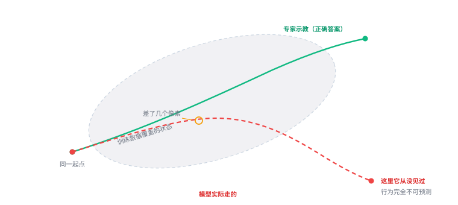

# 4.2 行为克隆：模仿学习为什么会翻车

## 最直白的做法

有了「图 + 指令 + 动作」的数据，最自然的训练方式是什么？

**让模型在同样的图和指令下，输出同样的动作。**

这叫**行为克隆**（Behavior Cloning，BC）。损失函数就是标准的监督学习：

$$
\mathcal{L} = -\log \pi(a_{\text{专家}} \mid o, l)
$$

也就是：让模型给「专家实际做的那个动作」分配尽量高的概率。

如果动作头是回归式的，那就是均方误差；如果是分布式的，就是负对数似然。本质一样——**让模型的输出逼近专家的输出。**

这件事在训练集上做得非常好。损失可以降到很低，验证集也能复现得很准。

**但只要一上真机，成功率会突然掉一大截。**

这个现象不是调参能解决的，它有个名字：**分布漂移（distribution shift）**，也叫**复合误差（compounding error）**。

---

## 一张图说清问题

<figure class="figure" markdown>

<figcaption class="caption">训练时模型只见识过灰色区域里的状态。一旦走出去，它就进入了「完全没学过」的地带。</figcaption>
</figure>

灰椭圆是**训练数据覆盖的状态**。

注意它的形状：不是一个圆，是一条**细长的带**。因为专家做同一个任务，走的路径大体一样，状态都集中在这条路径附近。

绿色是专家轨迹，从头到尾都在带子里。

红色是模型实际走的。**一开始几乎重合**——前几步模型预测得很准。

但在某个点，它偏了几个像素。可能是视觉抖动，可能是动作量化误差，也可能是那一帧的光照有点不一样。

**这本来是个小问题。** 如果人来做，偏了会自己修正。

但模型不会修正。因为它现在所处的位置，是训练数据里**从没出现过的状态**。它对这个状态该做什么，没有任何可靠的依据。

于是它基于一个错误的位置，做了下一个决策。误差被放大。

再下一步，偏得更多。

**它在带子里待的时间越短，走出带子后崩溃得越快。**

**类比**

你在学开车，教练教的全是「正常路况下怎么打方向盘」。

考试路线你练了 100 遍，闭着眼都能过。

但有一天路上突然窜出一只猫——这个情况你**从没在训练里见过**。

你慌了，猛打方向，车冲上人行道，然后又因为「冲上人行道」这个更陌生的状态继续犯错。

**不是你不会开车，是你没见过这个状态。**

---

## 为什么会越来越糟

严格说，误差的累积不是线性的。

假设每一步模型都可能引入一个大小为 $\epsilon$ 的小误差。走了 $T$ 步之后，总偏差的最坏情况大约是：

$$
O(\epsilon T^2)
$$

**平方级的增长。**

为什么是平方而不是线性？因为误差不只是「叠加」，它还**改变了后续的输入**。

第 1 步偏了 $\epsilon$，第 2 步是在「已经偏了 $\epsilon$ 的状态」上做决策，可能又偏 $\epsilon$，累计 $2\epsilon$。第 3 步在 $2\epsilon$ 的基础上再决策……偏差自己在滚雪球。

而一旦离开训练分布，$\epsilon$ 就不再是小量了——它会突然变大。

**所以实际曲线是：前 90% 走得很稳，最后 10% 突然崩。**

这也解释了为什么很多 VLA 演示看起来「前段流畅、后段猝死」。

---

## 四种解法

这个问题从 1990 年代就有人研究，到现在也没根治，但确实有几套有效的缓解手段。

### 解法一：闭环 —— 最重要的一条

**如果模型每一步都重新看一眼画面，那么「偏了」这个事实会立刻反映在观测里。**

模型看到「手偏左了」，下一帧就会输出「往右补一点」。误差被纠正了，不会滚雪球。

这就是为什么 VLA 几乎都是**闭环**的：每一帧（或每几步）都重新推理一次。

对比一下开环的做法：先规划一整条轨迹，然后闭着眼执行到底。开环的误差必然累积，闭环的误差会被反馈拉回来。

!!! note "闭环不是万能的"
    闭环能修正「位置偏差」，但修正不了「语义错误」。

    如果模型把「盘子」认成了「碗」，它每一步都在朝碗移动，闭环只会让它更坚定地走错。

    所以闭环解决的是「走得歪」，不是「想错了」。

### 解法二：动作块 —— 减少决策次数

[2.3 节](../part1-three-words/06-action.md)讲过：一次预测未来 $k$ 步。

从分布漂移的角度看，它把「$T$ 次独立决策」变成了「$T/k$ 次决策」。

**决策次数少了，累积的机会就少了。**

而且因为 $k$ 步是一次性生成的，它们内部是连贯的，不会出现「每一步都重新决策导致抖动」的问题。

代价是反应变慢（这在一章前面提过）。

### 解法三：DAgger —— 让专家在「错的状态」上标注

这是最直接的思路：

> 既然问题是「模型会走到专家没去过的状态」，那就**让专家在这些状态下给出正确动作**，补进训练集。

流程：

1. 用当前模型跑一遍，记录它实际经过的所有状态；
2. 让人类专家在这些状态上标注「正确该怎么做」；
3. 把这些新数据加进训练集，重新训练；
4. 重复。

理论上很完美，实践中很痛——**每一步都要人重新介入**，成本极高。

所以 DAgger 很少用于大规模 VLA，但在小规模、高风险场景（比如手术机器人）里仍然有价值。

### 解法四：把训练分布撑大

既然问题是「训练分布太窄」，那就把它撑宽。

具体做法：

- **采集时故意加扰动**：让操作员在物体位置、光照、背景上有变化；
- **多场景、多物体、多操作员**：数据越杂，带子越宽；
- **合成数据**：在仿真里生成大量变化（这条路的争议很大，见[6.1 节](../part5-reality/16-bottlenecks.md)）。

这本质上是在**降低「走出带子」的概率**，而不是提高「走出去之后的表现」。

---

## 一个容易混淆的点：BC 和强化学习

经常有人问：为什么不用强化学习？RL 不需要专家数据，可以在环境里自己试。

三个现实原因：

1. **真实世界试错的成本太高**。撞坏一个杯子是小事，撞坏一台几十万的设备、伤到人，是不可接受的。
2. **奖励函数写不出来**。「把杯子放好」这个任务的奖励怎么定义？离盘子近？那它会把杯子推过去。
3. **样本效率太低**。RL 通常需要百万级交互，而真实机器人一小时只能跑几百次。

所以机器人领域的主流是**模仿学习（BC）**，RL 只在仿真里、或者在模仿学习之后的精调阶段用。

这也是一个重要的认知：**VLA 本质上是模仿学习，不是强化学习。** 它学的是「人怎么做」，不是「怎么做能拿高分」。

---

## 那为什么现在的 VLA 效果还不错

看到这里你可能会疑惑：既然分布漂移这么严重，为什么 OpenVLA、π₀ 这些模型在真机上还能跑到 80% 以上的成功率？

四个原因，按贡献大小排：

**1. 数据规模上去了**

早期 BC 用几十条轨迹，现在用几十万条。带子宽了，「走出去」的概率低了。

**2. 视觉预训练提供了鲁棒性**

模型在互联网数据上见过各种光照、角度、背景。稍微变一点，它不会像从零训练的模型那样直接崩。

**3. 动作块 + 闭环的组合**

每步都看，但不必每步都决策，两者结合既纠正了偏差，又减少了累积点。

**4. 评测方式的宽容**

这一点要诚实：论文里的「成功率 85%」，通常是在**和训练数据非常相似的场景**下测的。换个房间、换个光照，数字会掉很多。

**所以「效果不错」和「可靠」之间还有很长的路。** 这是[第六部分](../part5-reality/16-bottlenecks.md)要讲的主题。

---

## 本章小结

行为克隆的逻辑简单到不能再简单：**看着人怎么做，学着做。**

它的问题也简单到不能再简单：**一旦做错一点，就会进入没学过的处境，然后错得更厉害。**

四种解法分别对应四个角度：

| 解法 | 针对什么 |
|---|---|
| 闭环 | 让偏差被看见、被纠正 |
| 动作块 | 减少决策次数，减少累积点 |
| DAgger | 在错的状态上补标注 |
| 撑大分布 | 降低出界的概率 |

**没有一种能根治。** 因为根本问题是：你无法用有限的数据，覆盖无限的可能状态。

**自测三问**

1. 用「学开车」的类比，解释分布漂移是怎么发生的。为什么小误差会变成大错误？
2. 为什么误差累积大致是平方级的，而不是线性的？
3. 闭环能解决分布漂移吗？它能解决什么、不能解决什么？

行为克隆的致命伤是分布漂移：训练只见识过专家走过的窄带，一旦偏出去就失去依据，误差滚雪球。
闭环 + 动作块 + 更宽的数据分布能缓解，但无法根治。

---

<a class="md-button" href="../12-pretrain/">下一节：预训练与后训练 →</a>
