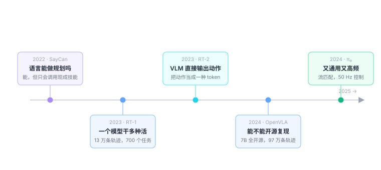

# 5.1 谱系总览：五年，五个转折

## 别按时间背，按问题记

VLA 的论文列表如果按时间排，会让人绝望——每年几百篇，名字全是缩写。

但真正改变方向的，只有五次。

每一次都是因为**上一代暴露了一个解决不了的问题**：

<figure class="figure" markdown>

<figcaption class="caption">五次转折，五个问题。记住问题，就记住了谱系。</figcaption>
</figure>

---

## 转折一：语言能做规划吗？（2022 · SayCan）

**背景**

2022 年，大语言模型刚刚展现出「会推理」的苗头。所有人都在问：能不能让 LLM 控制机器人？

**做法**

SayCan 的思路很聪明：**LLM 不做动作，只做规划。**

```text
你说：「我洒了咖啡，帮我清理一下」
LLM 想：需要 ① 找到海绵 ② 拿起海绵 ③ 擦桌子
然后调用现成的技能库：navigate(sponge) → grasp(sponge) → wipe(table)
```

LLM 负责「拆解任务」，底层技能库负责「真的动」。

**它证明了什么**

**语言模型确实懂「做事的顺序」**——这是常识，而且是可以从文本里学到的。

**它没解决什么**

底层技能还是人写死的。换一个任务、换一个物体，技能库就不够用了。

**留下的结论**：语言擅长「决定做什么」，不擅长「怎么做」。这个分工，至今没有变。

---

## 转折二：一个模型能干多种活吗？（2023 · RT-1）

**背景**

既然技能库不够灵活，那能不能让一个模型学会所有技能？

**做法**

RT-1 用了一个在当时很激进的方案：

- 用 Transformer（不是 CNN）处理图像序列；
- 喂给它 **13 万条轨迹、700 多个任务、13 种机器人**的数据；
- 一个模型，输入图和指令，输出动作。

**它证明了什么**

**规模能买来通用性。**

在这之前，机器人的共识是「一个任务一个策略」。RT-1 证明：只要数据够多、模型够大，一个网络可以同时会 700 种任务，而且新任务的表现比专用模型还好。

**它没解决什么**

13 万条数据，只有 Google 采得起。而且模型对**没见过的物体**依然很弱——因为它没有「世界知识」，只有「这 13 万条数据里的模式」。

---

## 转折三：VLM 能直接输出动作吗？（2023 · RT-2）

**背景**

RT-1 缺的是常识。而常识在视觉语言模型（VLM）里——它们在互联网图文上训练过，认识一万种物体。

**那为什么不直接拿一个 VLM 来当机器人？**

**做法**

RT-2 的做法，是 VLA 这个名字的起点：

> **把动作当成一种「外语」。**

具体：把每个动作维度离散成 256 档，映射成 256 个特殊的 token，加进 VLM 的词表。

于是「输出一个动作」就变成了「输出几个 token」——**和生成一句话没有区别**。

然后拿 robot 数据微调这个 VLM，它就从「会描述图片」变成了「会输出动作」。

**它证明了什么**

**VLM 的语义知识可以迁移到动作上。**

RT-2 能理解「把它放到和可乐罐一样颜色的地方」这种指令——因为「可乐罐」「颜色」这些概念它早就懂了。

**这是 VLA 相对于 RT-1 的质变**：不是「见了更多数据」，而是「带着一整个互联网的常识进来」。

**它没解决什么**

- 太慢。自回归生成 7 个 token，一次几百毫秒，只能跑 3–5 Hz；
- 太大。55B 参数，普通人跑不动；
- 没开源。

---

## 转折四：能不能开源复现？（2024 · OpenVLA）

**背景**

RT-2 之后，这个领域被几家大厂垄断。学术界只能看论文，复现不了。

**做法**

OpenVLA 把配方完整公开：

| 组件 | 选择 |
|---|---|
| 主干 | Llama 2 7B |
| 视觉 | DINOv2 + SigLIP 双编码器 |
| 动作头 | 自回归，256 档离散 |
| 数据 | Open X-Embodiment 的 97 万条轨迹 |
| 参数量 | 7B |

**加上权重、代码、训练脚本全部开源。**

**它证明了什么**

**这件事不再是巨头的专利。**

一个实验室用 8 张 A100 就能微调出自己的 VLA。这直接导致 2024 年下半年开始，VLA 论文数量爆炸。

**它没解决什么**

**它继承了 RT-2 的所有毛病**：自回归慢（约 6 Hz）、离散化损失精度。

而且它的泛化能力在真实场景里明显不如 demo 视频——换个背景、换个光照，成功率掉得很厉害。

---

## 转折五：能不能又通用又高频？（2024 · π₀）

**背景**

到此为止，所有 VLA 都面临一个根本矛盾：

> **要通用，就得上大模型；上了大模型，就跑不快；跑不快，就控制不好。**

**做法**

π₀ 的答案：**换一种生成动作的方式。**

不再把动作当 token 一个个吐，而是用**流匹配**——一次生成一整个动作块（50 步），并且用 10 步去噪搞定。

结果：

| | RT-2 / OpenVLA | π₀ |
|---|---|---|
| 参数量 | 55B / 7B | 3.3B |
| 动作生成方式 | 自回归 token | 流匹配 |
| 控制频率 | 3–6 Hz | **50 Hz** |
| 一次输出 | 7 个 token | 50 步 × 动作维度 |

**它证明了什么**

**「大模型」和「高频控制」可以同时成立**——只要你不用语言模型的方式生成动作。

**这条思路的意义**：动作不是语言。语言可以慢慢一个字一个字想，动作必须一口气做完。

---

## 两条路线的合流

回头看这五年，其实是两条技术路线在各自发展，最后汇合。

**路线 A：从语言模型改**

```text
LLM → VLM → VLA
优点：有语义、有常识
缺点：慢、不会连续控制
```

**路线 B：从控制策略改**

```text
行为克隆 → ACT / Diffusion Policy → 通用策略
优点：快、擅长连续动作
缺点：没有语义，听不懂人话
```

**2024 年之后，这两条线合流了。**

π₀ 就是典型：主干用 PaliGemma（路线 A 的产物），动作头用流匹配（路线 B 的产物）。

**理解这个合流，比记住任何一个模型名都有用。**

因为它告诉你：未来的架构大概率是「强语义主干 + 高效动作头」的组合，而不是纯粹的某一边。

---

## 2025 之后：三个新方向

谱系图到这里还没结束。2025 年之后出现了三个明显的新方向，各自解决不同的问题：

### 方向一：分层（π₀.₅）

**问题**：单一模型做长任务时，容易在中途「忘记目标」。

**做法**：把任务拆成「高层想做什么」和「低层怎么做」两层，高层输出子任务，低层执行。

细节在[第 5.3 节](15-hierarchical.md)。

### 方向二：双系统（GR00T N1 等）

**问题**：一个模型既要「慢思考」又要「快反应」，本身矛盾。

**做法**：两个模型——一个大的慢速做规划，一个小的快速做反射。参考人类的大脑系统一 / 系统二。

### 方向三：商业化落地

**问题**：实验室 demo 和真实产品之间隔着可靠性、成本、安全。

**代表**：Gemini Robotics（Google）、Helix（Figure）、各种人形机器人公司的自研 VLA。

**这些方向都还在早期。** 两年后再写这一节，内容会完全不一样。

---

## 怎么用这张地图读新论文

拿到任何一篇 VLA 论文，问四个问题，就能给它定位：

| 问题 | 看哪里 | 说明 |
|---|---|---|
| **1. 主干是什么？** | 架构图左侧 | VLM 微调（有常识）还是从零训练（更轻） |
| **2. 动作头是什么？** | 架构图右侧 | 自回归（慢但简单）/ 扩散（准但更慢）/ 流匹配（快） |
| **3. 数据从哪来？** | 实验设置 | 自采（少而精）/ 公开数据（多而杂）/ 混合 |
| **4. 在哪评测？** | 实验部分 | 仿真 / 真机 / 有没有做泛化矩阵 |

**第四个问题最能暴露水分。**

只报仿真结果的，真机能力存疑；只报真机但没做干扰测试的，泛化能力存疑；做了泛化矩阵但只测「新物体」的，说明其他三维心里没底。

---

## 一句话总结

这个领域看起来变化极快，但骨架很稳：

**用语言模型提供常识，用专门的机制生成动作，用尽可能多的数据覆盖尽可能多的场景。**

每一次转折，都是在调这三者的配比。

<div class="quiz" markdown>
**自测三问**

1. 五次转折分别解决了上一代的什么问题？试着用「上一代缺什么」的句式各说一句。
2. 路线 A（从语言模型改）和路线 B（从控制策略改）各自的优势和短板是什么？π₀ 是怎么合流的？
3. 拿到一篇新论文，四个定位问题分别是什么？为什么说第四个最能暴露水分？
</div>

<div class="takeaway" markdown>
五年五次转折，本质是两条路线在合流：语言模型提供语义，专用机制生成动作。
读新论文先问四件事——主干、动作头、数据来源、评测方式。
</div>

---

<a class="md-button" href="../14-pi0/">下一节：π₀ 与流匹配 →</a>
