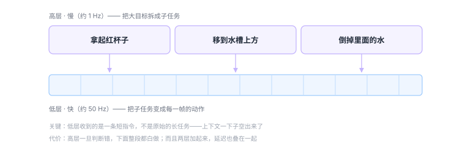

# 5.3 分层 VLA：让大脑和小脑分工

## 长任务的困境

一个 VLA 可以漂亮地完成「把杯子放到盘子上」。

但如果你说「把厨房收拾干净」呢？

三个东西同时坏掉：

**1. 视野太短**

π₀ 一次规划 1 秒。收拾厨房要 10 分钟。

**600 个动作块，每一块都是独立决策的。** 没有哪个环节知道「我在做第几步」「还剩什么没做」。

**2. 上下文被吃光**

图像 token 已经占了上下文的一大半（[2.1 节](../part1-three-words/04-vision.md)算过）。剩下的空间装一条短指令还行，装「收拾厨房」这种需要长期记忆的任务，根本没有余量。

**3. 没有「进度感」**

单一模型做长任务时，会在中途「飘走」——本来在擦桌子，擦着擦着开始摆弄旁边的杯子。因为它没有一个「目标状态」在约束它。

<div class="analogy" markdown>
**类比**

让一个人蒙着眼睛擦桌子。

你告诉他「擦干净」，他会擦——但擦着擦着就偏了，因为他看不见「哪里还没擦」。

如果每隔十秒有人在他耳边说一句「左边还有一块」，他就能继续。

**分层 VLA 就是那个在耳边说话的人。**
</div>

---

## 结构：两层，两种速度

<figure class="figure" markdown>

<figcaption class="caption">高层把大目标翻译成一串短指令，低层只负责执行当前这一条。</figcaption>
</figure>

**高层（慢）**

- 看全局：相机画面 + 任务进度
- 输出：一个**子任务描述**（「拿起红杯子」），不是动作
- 频率：约 1 Hz，甚至更低

**低层（快）**

- 输入：画面 + **当前子任务**（不是原始的长任务）
- 输出：动作块
- 频率：几十 Hz

**这个设计解决了三个问题：**

| 问题 | 怎么解决 |
|---|---|
| 视野太短 | 高层负责「下一步做什么」，低层只管眼前这一秒 |
| 上下文吃光 | 低层收到的是「拿起红杯子」这 5 个字，不是「把厨房收拾干净」 |
| 没有进度感 | 高层每次都会重新看一眼全局，重新判断「现在该做哪一步」 |

---

## 三种实现方式

分层不是新想法——[SayCan](13-lineage.md) 在 2022 年就是分层的。但具体怎么落地，差别很大。

### 方式一：松耦合（两个独立模型）

高层是一个语言模型，低层是一个 VLA，两者**完全独立**，通过文本传递信息。

```text
LLM（GPT-4 级别） → "拿起红杯子" → VLA → 动作
```

**优点**：模块化，哪一层坏了换哪一层；高层可以直接用最强的商用模型。

**缺点**：
- 延迟叠加。高层想 500 毫秒，低层再算 20 毫秒，加起来反应变慢；
- 接口太窄。高层只能传一句话，丢掉了大量视觉细节（它看到的东西没法传给低层）；
- 训练割裂。两层各自优化，没有联合调优。

**代表**：SayCan、Hi Robot。

### 方式二：紧耦合（一个模型，两套输出）

**同一个模型**，通过不同的 prompt 或不同的输出头，在「高层模式」和「低层模式」之间切换。

```text
输入：任务 + 画面
  ├─ 高层模式 → 输出子任务文本
  └─ 低层模式 → 输出动作
```

**优点**：共享同一份视觉理解，信息不丢；训练可以联合。

**缺点**：一个模型要同时擅长两件事，容易顾此失彼。

**代表**：RT-H、π₀.₅。

### 方式三：隐式分层（不定义子任务）

干脆不显式生成「子任务」这种中间表示，而是让高层输出一个**隐向量**，低层拿这个向量当条件。

**优点**：不受限于语言的表达能力——有些「意图」用语言描述反而丢信息。

**缺点**：不可解释。你没法知道高层到底「想」了什么。

**代表**：一些研究性工作。

---

## π₀.₅ 的做法：一个模型，两个阶段

π₀.₅ 是这套思路目前最完整的实现，值得细看。

**它的核心设计**：

1. **同一个模型**，先做「高层推理」，再做「低层执行」；
2. 高层输出的子任务描述，直接作为低层的输入条件；
3. 训练时用**异构数据**（互联网数据、多机器人数据、移动操作数据）联合训练。

**为什么这很重要**

π₀.₅ 展示了一个此前没有的能力：**在新房子里做清洁任务**。

模型从没进过那个房子，但它能：
- 看懂「厨房在哪」（语义理解）；
- 决定「先收拾台面，再扫地」（任务分解）；
- 执行「抓住这个瓶子」（动作控制）。

**这三件事分别对应三种能力，单一模型很难同时做好。**

**一个关键细节：它怎么知道「做完了」**

高层每执行完一个子任务，会重新看一眼画面，判断：
- 这个子任务完成了吗？
- 下一个该做什么？

这个「重新看一眼」的动作，就是它对抗漂移的办法——和[4.2 节](../part3-training/11-behavior-cloning.md)讲的闭环是同一个道理，只是提升到了任务层。

---

## 双系统：另一个角度的分层

NVIDIA 的 GR00T N1 用了另一种分法，名字借自认知科学：

| | System 2（慢） | System 1（快） |
|---|---|---|
| 类比 | 人类「想一想再动」 | 人类「条件反射」 |
| 实现 | 视觉语言模型 | 扩散 Transformer |
| 频率 | 约 10 Hz | 约 100 Hz |
| 负责 | 理解场景、决定意图 | 生成精细动作轨迹 |

**和「高层/低层」的区别在哪**

高层/低层是按**任务粒度**分的：一个管「做什么」，一个管「怎么做」。

双系统是按**反应速度**分的：一个管「想清楚」，一个管「快反应」。

两者有重叠，但关注点不同。双系统更像是在说：**有些动作需要想，有些动作不能想——想了就慢了。**

比如抓杯子这个动作，一旦决定要抓，手指的收拢应该是反射式的，不该再经过一次大模型推理。

---

## 分层的代价

分层不是免费的。三个新问题：

### 代价一：延迟叠加

高层 500 毫秒 + 低层 20 毫秒 = 520 毫秒。

如果高层每 1 秒才更新一次，那么在最坏情况下，低层要拿着一个**已经过时 1 秒的指令**执行。

**这就是为什么高层不能太慢**，也是为什么有些系统让高层「异步」运行——低层继续执行上一个子任务，高层在后台算下一个。

### 代价二：高层的错误会放大

如果高层判断错了（比如该拿杯子却决定去开抽屉），低层会非常忠实地执行这个错误决定，而且执行得很好。

**单一模型的错误是「动作不准」，分层模型的错误是「方向错了」。** 后者更难挽回。

### 代价三：接口设计很难

「子任务」应该多细？

- 太粗（「收拾桌子」）：低层还是不知道怎么动；
- 太细（「伸出食指 3 厘米」）：失去了分层的意义，等于让高层做低层的活。

实践中常见的粒度是「一个可以在 1–5 秒内完成的动作」，比如「拿起杯子」「打开抽屉」。

**这个粒度是经验值，没有理论指导。** 这也是分层 VLA 目前还比较「手艺活」的原因。

---

## 一个值得思考的问题

分层让系统更强了，但它也暴露了一件事：

> **我们其实不太清楚「一个任务」到底是什么。**

对人类来说，「收拾厨房」是一个任务。但对机器来说，它是一千个动作的序列，中间有无数个可以重新决策的点。

分层是在用工程手段回避这个问题——**不去定义「任务」，而是定义「子任务」，然后把子任务一层层拆下去。**

如果拆得足够细，最底层就变成了动作。这在实践中有效，但它不是对「智能」的解释，只是一个可用的组织方式。

**这也是为什么很多研究者认为，分层 VLA 是过渡方案，不是终局。**

<div class="quiz" markdown>
**自测三问**

1. 单一 VLA 做长任务会坏在三个地方，分别是什么？分层分别怎么解决？
2. 「高层/低层」和「双系统（System 1/2）」这两种分法，关注点有什么不同？
3. 分层引入了哪三个新代价？为什么说「高层的错误比低层的错误更难挽回」？
</div>

<div class="takeaway" markdown>
分层用「慢的高层 + 快的低层」解决长任务的三重困境：视野、上下文、进度感。
代价是延迟叠加、错误放大、以及「子任务该多细」这个说不清的问题。
</div>

---

<a class="md-button" href="../../part5-reality/16-bottlenecks/">进入第六部分：诚实的部分 →</a>
